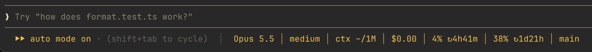

# claude-code-status-bar

A light status bar for Claude Code. It sits on the line under the prompt, next to `⏵⏵ auto mode on`, in the same color:




```
⏵⏵ auto mode on (shift+tab to cycle)  │  Sonnet 5.5 │ high │ ctx 14k/200k 7% │ $0.12 / $1.84 │ 4% ↻1h0m │ 13% ↻3d4h │ main
```

| Field | Meaning |
| --- | --- |
| `Sonnet 5.5` | current model (updates after `/model`) |
| `high` | reasoning effort of the last request |
| `ctx 14k/200k 7%` | context tokens used / window size, percent used |
| `$0.12 / $1.84` | cost of the last answer / whole session, as `/cost` counts it (API list price; on a subscription it is the API equivalent, not a bill) |
| `4% ↻1h0m` | 5-hour usage limit and time until it resets |
| `13% ↻3d4h` | weekly usage limit and time until it resets (always after the 5-hour one) |
| `main` | current git branch of the working directory; a short commit like `(a1b2c3d)` on a detached HEAD; hidden outside a repository or when `git` is not on `PATH` |

Limits show on a Claude subscription only, after the first model response.

Model and effort changes from `/model` or `/effort` show within a second, without waiting for the next response. A branch switch shows within about 5 seconds.

Works on macOS, Linux and Windows; the branch needs `git` on `PATH`. On a narrow terminal the line is cut at the right edge instead of wrapping.

## Install

In Claude Code:

```
/plugin marketplace add SDH4114/claude-code-status-bar
/plugin install cc-status-bar@amikolabs.com
```

Then run `/reload-plugins` or restart Claude Code.

Or from a shell:

```sh
claude plugin marketplace add SDH4114/claude-code-status-bar
claude plugin install cc-status-bar@amikolabs.com
```

## Update

```
/plugin marketplace update amikolabs.com
```

## Uninstall

```
/plugin uninstall cc-status-bar@amikolabs.com
```

## Develop

```sh
claude plugin validate .
claude plugin test .
```

## License

MIT
