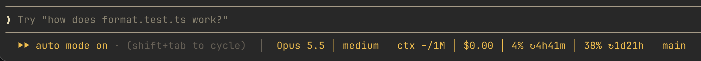
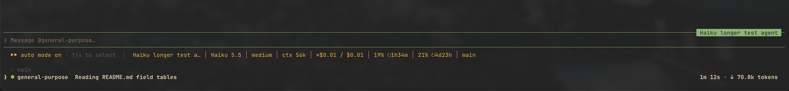
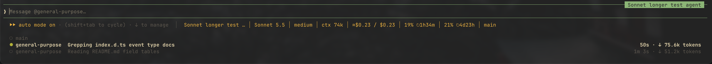

# claude-code-status-bar

A light status bar for Claude Code. It sits on the line under the prompt, next to `⏵⏵ auto mode on`, in the same color. Subagents and teammates get a line of their own (see [Per-agent line](#per-agent-line)):




```
⏵⏵ auto mode on (shift+tab to cycle)  │  Sonnet 5.5 │ high │ ctx 14k/200k 7% │ $0.12 / $1.84 │ 4% ↻1h0m │ 13% ↻3d4h │ main
```

| Field | Meaning |
| --- | --- |
| `Sonnet 5.5` | current model (updates after `/model`) |
| `high` | reasoning effort of the last request |
| `ctx 14k/200k 7%` | context tokens used / window size, percent used |
| `$0.12 / $1.84` | cost of the last answer / whole session, as `/cost` counts it (API list price; on a subscription it is the API equivalent, not a bill) |
| `4% ↻1h0m` | 5-hour usage limit and time until it resets |
| `13% ↻3d4h` | weekly usage limit and time until it resets (always after the 5-hour one) |
| `main` | current git branch of the working directory; a short commit like `(a1b2c3d)` on a detached HEAD; hidden outside a repository or when `git` is not on `PATH` |

Limits show on a Claude subscription only, after the first model response.

### Per-agent line

Each subagent and teammate has its own line. When you open an agent's transcript from the tasks list, the footer switches to that agent within a second and shows its own model, effort, context, cost and branch. Two agents running side by side, one on Haiku and one on Sonnet:





```
Sonnet longer test … │ Sonnet 5.5 │ medium │ ctx 74k │ ≈$0.23 / $0.23 │ main
```

| Field | Meaning |
| --- | --- |
| `Sonnet longer test …` | the agent's name (its `name`, else the task description), cut at 20 characters |
| `Sonnet 5.5` / `medium` | the model and effort of the agent's last request |
| `ctx 74k` | the agent's own context; `/window` and percent are added when it runs on the session's model |
| `≈$0.23 / $0.23` | estimated cost of the agent's last turn / all its turns |
| `main` | the branch of the agent's own directory (a worktree agent shows its worktree's branch) |

`≈` marks an estimate: Claude Code does not give plugins a cost per agent, so it is counted from the agent's tokens at API list price (cache writes at the 5-minute rate, fast mode not counted) and can differ from `/cost`. A model missing from the price table shows no cost.

The account's limits are the same for every agent, so the agent line leaves them out; they stay on the main line.

Back on the main conversation the line shows the session again; the session cost there includes its agents.

Model and effort changes from `/model` or `/effort` show within a second, without waiting for the next response. A branch switch shows within about 5 seconds.

Works on macOS, Linux and Windows; the branch needs `git` on `PATH`. On a narrow terminal the line is cut at the right edge instead of wrapping.

## Usage by day

`/usage-stats` shows every recorded day, newest first: per model the responses, input, output and cache tokens and the estimated cost, plus how much of the 5-hour and weekly limits the day used. `/usage-stats 7` shows the last 7 recorded days (days with no use are skipped, not counted).

```
2026-11-12 · 5h +38% (peak 72%) · week +9% (peak 27%)
  Opus 5.5   41 req   in 1k  out 52k  cache r 3.1M  w 209k   ≈$2.71
  Haiku 5.5   3 req   in 9k   out 2k   cache r 39k   w 12k  ≈<$0.01
  all        44 req  in 10k  out 54k  cache r 3.1M  w 221k   ≈$2.71

Total 2026-11-12
  Opus 5.5   41 req   in 1k  out 52k  cache r 3.1M  w 209k   ≈$2.71
  Haiku 5.5   3 req   in 9k   out 2k   cache r 39k   w 12k  ≈<$0.01
  all        44 req  in 10k  out 54k  cache r 3.1M  w 221k   ≈$2.71
```

- Every model response is counted, the main conversation's and every agent's, under the day it arrived (local time).
- `≈$` is the API list price of the tokens, as for agents above (cache writes at the 5-minute rate), so it can differ from `/cost`.
- `5h +38%` is how much the 5-hour limit's percent rose that day, summed over its windows (a new window counts from 0); `peak` is the highest reading. The weekly one the same. Use outside Claude Code (claude.ai, another machine) shows up on the next reading here.
- Counting starts when the plugin is installed: there is no history from before.
- Records are one JSON file per session in `~/.claude/cc-status-bar/usage/` (`$CLAUDE_CONFIG_DIR/cc-status-bar/usage/` when set), written at most every 10 seconds. Delete the folder to start over.

## Install

In Claude Code:

```
/plugin marketplace add SDH4114/claude-code-status-bar
/plugin install cc-status-bar@amikolabs.com
```

Then run `/reload-plugins` or restart Claude Code.

Or from a shell:

```sh
claude plugin marketplace add SDH4114/claude-code-status-bar
claude plugin install cc-status-bar@amikolabs.com
```

## Update

```
/plugin marketplace update amikolabs.com
```

## Uninstall

```
/plugin uninstall cc-status-bar@amikolabs.com
```

## Develop

```sh
claude plugin validate .
claude plugin test .
```

## License

MIT
